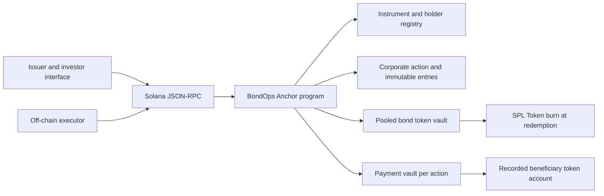

# BondOps — technical overview

## Architecture

The React interface calls an Anchor program directly through Solana JSON-RPC. Program accounts are the source of truth for instrument terms, positions, entitlements and outcomes. SPL Token accounts are the source of truth for payment and bond balances. There is no backend entitlement calculator.



### Accounts and authority

- **Instrument PDA:** seeds `instrument / issuer public key / u64 instrument ID`. Stores immutable face value, annual coupon basis points, frequency, period count, start time, maturity, closed/open issuance, outstanding quantity and holder positions.
- **Bond mint:** zero-decimal SPL Token mint. Its mint authority is the instrument PDA. Only the program can mint; program issuance additionally requires the issuer's signature and unsealed issuance.
- **Bond vault PDA:** seeds `bond-vault / instrument`. Owned by the SPL Token program; token authority is the instrument PDA. The tokens back positions in the program registry.
- **Action PDA:** seeds `action / instrument / u64 nonce`. Contains type, record timestamp, per-bond amount, snapshot slot, immutable beneficiary quantities and amounts, settlement flags, voting flags and aggregate outcomes.
- **Payment vault PDA:** seeds `payment-vault / action`. Its mint must equal the instrument's six-decimal payment mint. Its token authority is the action PDA.
- **Investor payment accounts:** SPL Token accounts whose mint is the configured payment mint and whose owner must equal the beneficiary stored in the action entry.

The issuer can issue and fund, but cannot directly sign as either PDA. Position transfers require the registered holder's signature. Snapshot, settlement and vote finalization are executable by anyone; they cannot select arbitrary beneficiaries or change an entitlement.

## Record-date logic

Coupon timestamps are derived on-chain from `started_at + coupon_number × interval_seconds`. Maturity is `started_at + periods × interval_seconds`. A vote has a future record timestamp and a fixed close timestamp.

Actions are queued ahead of time. The queue is ordered by record timestamp; a coupon takes priority over principal redemption when both have the maturity timestamp. `transfer_position` checks Solana's Clock and rejects position changes once the earliest unsnapshotted record date is reached. Thus, an offline executor cannot permit a transfer after the cutoff.

`snapshot` accepts only the earliest pending action, and only at/after its record time. It copies the complete controlled registry into the action account and calculates entitlements. It also verifies:

`sum(registry positions) = instrument outstanding = custody balance = bond mint supply`.

The snapshot stores both the contractual record timestamp and the actual execution timestamp/slot. If execution is late, the positions are still correct because every position-changing path was frozen at the cutoff. This is not a historical RPC balance lookup. After the snapshot, transfers resume if the next cutoff and maturity have not arrived.

At maturity, transfers are permanently blocked. The final coupon must be snapshotted before redemption can reach the head of the queue. After the redemption snapshot, the instrument enters its redeeming phase. Other already-snapshotted coupon obligations can still be settled after principal redemption because their entries preserve historical ownership.

## Entitlement calculations

Payment amounts are six-decimal token micro-units. Bond quantities are whole units. No floating-point arithmetic is used on-chain.

```text
coupon_per_bond = floor(face_value_micro × annual_bps / (10,000 × frequency))
coupon_entitlement = recorded_quantity × coupon_per_bond
principal_entitlement = recorded_quantity × face_value_micro
```

The floor is applied once per bond; its maximum residual is less than one payment micro-unit per bond per coupon. This rule is explicitly part of the prototype. Multiplication uses checked `u128` intermediates for the coupon rate and checked `u64` totals. Issuance rejects outstanding principal that cannot be represented in `u64`.

For face value 1,000,000,000 micro-units, 1,000 basis points and frequency 2, one bond receives 50,000,000 micro-units per coupon. Ten recorded bonds receive 500,000,000 micro-units, displayed as $500.00 DemoUSD.

## Settlement and recovery

An issuer funds an independent vault for each payment action. Before any investor is paid, the program requires that vault to cover the entire remaining obligation. Partial funding cannot selectively pay some investors first.

Each settlement validates the action/instrument relation, configured token mint, recorded beneficiary account owner and unpaid flag. It transfers the immutable amount and writes the paid flag and settlement timestamp in the same Solana transaction. The completed status is set only when every positive-position entry is paid.

An executor can stop after any transaction. A fresh executor reads the action account and processes entries whose paid flag is false. The program rejects another transaction for an already-paid entry. Transaction/network retry and entitlement replay are distinct; the durable action state handles the latter.

Any surplus funding can be reclaimed only after the action is completed, only with the issuer's signature, and only to an account owned by the issuer with the configured payment mint. There is no withdrawal of cash reserved for an incomplete obligation.

## Principal redemption

The redemption snapshot locks the quantities being retired. For each holder, the program transfers principal, reduces the registry position and outstanding quantity, burns the same quantity from custody, and updates the action entry within one transaction. A failed check, payment CPI or burn CPI rolls back every change.

The entire issue is processed across multiple holder transactions. Per-holder payment and burn are atomic; whole-issue settlement is resumable. When all entries are settled, `burned_quantity` equals the snapshot's total quantity, supply and custody reconcile to zero, and the instrument is marked redeemed.

## Additional corporate action: voting

Voting uses its own immutable holder snapshot. `cast_vote` requires the recorded wallet's signature and a positive snapshot quantity. A ballot cannot be cast twice; transferring positions after the cutoff cannot move or duplicate voting rights.

The published rule is at least 50% participation and a strict majority of votes cast. Ties fail. Finalization uses the on-chain clock, writes quorum and pass/fail flags, and closes the action. The example vote approves publication of quarterly reports. It records a decision; it does not automatically amend economic terms.

## Implemented / simulated boundary

All holder, record-date, entitlement, payment, redemption and voting logic executes in Solana. Localnet uses the actual compiled SBF program and the SPL Token program. DemoUSD is a test payment token. Investor identities, KYC, KASE connectivity and actual fiat settlement are simulated. No legal claim that a test token is a registered security is made.

This architecture demonstrates a controlled registrar model with program custody and up to 32 lifetime holder wallets. Production use requires calendar/day-count rules, tax treatment, authenticated wallet workflows, regulated infrastructure interfaces, operational scheduling, scalable checkpointing, dependency hardening and an independent security review.
